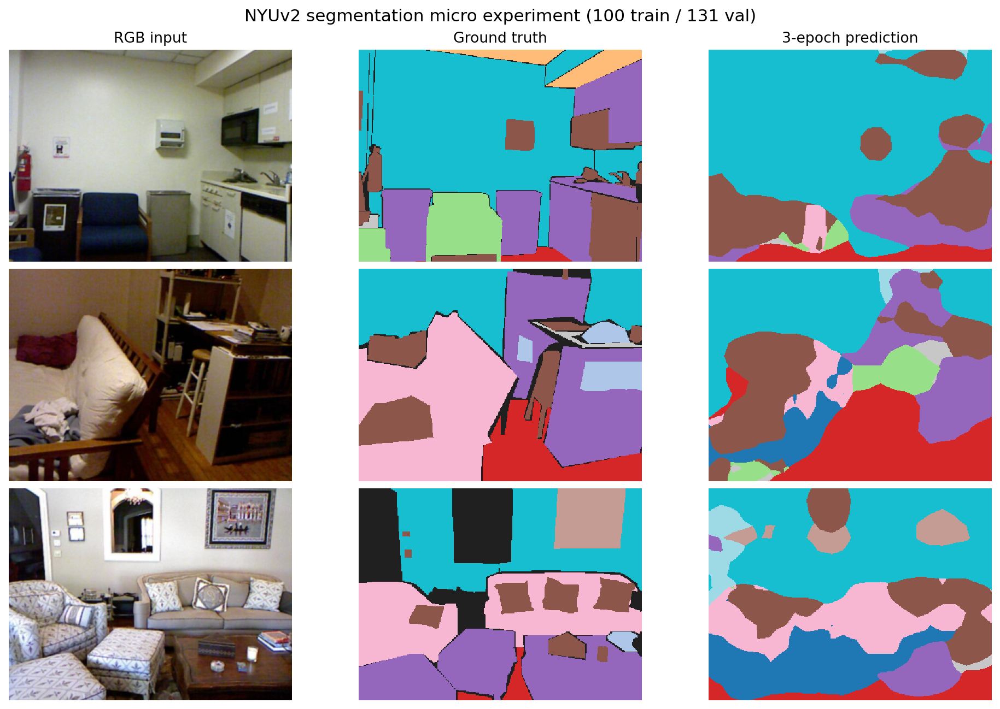

# M5 Real-Data Micro Benchmark

This is a pipeline and learning-signal check, not a paper-quality result.

- Dataset: the project's preprocessed NYUv2 train/val split
- Train sample: 100 images selected with stride 8
- Validation sample: 131 images selected with stride 5
- Training: 3 epochs, batch size 2, two DataLoader workers, four CPU threads
- Optimizer: Adam, learning rate 1e-4, weight decay 1e-5
- Encoder: ImageNet-pretrained torchvision ResNet-50
- Device: Apple M5 Metal/MPS, PyTorch 2.12.0

## Results

| Method | Seg mIoU | Seg pixel accuracy | Depth abs. error | Normal mean angle |
|---|---:|---:|---:|---:|
| STL | 0.2413 | 0.5691 | 1.7289 | 40.46 deg |
| MTL | 0.2368 | 0.5668 | 1.8346 | 39.99 deg |
| Weight averaging | 0.1980 | 0.5347 | 1.6580 | 40.66 deg |

The segmentation majority-class pixel accuracy on this validation sample is
0.2529. The STL pixel accuracy therefore reflects real learning rather than
always predicting the most common class.

Weight averaging improved depth relative to STL in this short run, but degraded
segmentation. MTL was close to STL on segmentation and normal estimation but
weaker on depth. These differences are not reliable at 3 epochs and should be
re-evaluated with full data and multiple seeds.

The 1.9 GB checkpoint set remains at
`/tmp/nyuv2-micro.jT08rM/runs_micro_3ep` for inspection or follow-up runs.

